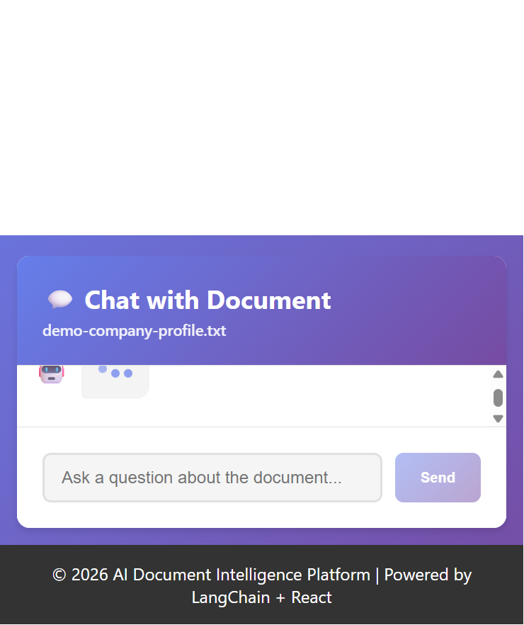

# AI Document Intelligence Platform

> Turn long documents into searchable, question-answering knowledge using a local RAG stack built with React, Node.js, PostgreSQL, and AI models.

[](LICENSE)
[](frontend/)
[](backend/)
[](docker-compose.yml)

AI Document Intelligence is a full-stack document Q&A system for developers who want to upload files, retrieve the most relevant passages, and ask grounded questions without building a custom RAG pipeline from scratch. It works with PDFs, DOCX, and TXT files and supports both Anthropic Claude and OpenAI.

## Star if you find this useful!

If you find this useful, please:

- ⭐ Star the repo on GitHub
- 🍴 Fork it
- 💬 Leave feedback in issues

## Why this project exists

Most organizations have valuable information trapped inside PDFs, contracts, reports, and internal notes. Standard document search often misses context or returns irrelevant snippets. This project solves that by combining:

- document ingestion and parsing
- chunking and embedding generation
- semantic retrieval from PostgreSQL with pgvector
- LLM-powered question answering grounded in the source document

## What it does

This app lets you:

- upload PDF, DOCX, and TXT files
- extract and clean the text from each document
- split documents into searchable chunks
- generate embeddings and store them in PostgreSQL
- ask natural-language questions about the uploaded content
- compare or switch between Anthropic Claude and OpenAI providers
- run the full stack locally with Docker or direct Node development

### Example workflow

1. Upload a company profile, contract, or research document.
2. The backend parses the file and creates embeddings.
3. The app retrieves the most relevant passages.
4. The model answers with references grounded in the source material.

## Demo

This project includes a working UI and example document flows. The screenshots below show the app in action.




### Question flow walkthrough


## Features

- Upload PDF, DOCX, DOC, and TXT files
- Parse documents with a document ingestion pipeline
- Convert content into embeddings using OpenAI or Anthropic-backed workflows
- Store searchable vector data in PostgreSQL + pgvector
- Use retrieval-augmented generation (RAG) for grounded Q&A
- Search and retrieve the most relevant document chunks
- Keep the app self-hosted and customizable for private data
- Run the full stack locally with Docker Compose or npm scripts

## Tech stack

| Layer | Technologies |
| --- | --- |
| Frontend | React 18, TypeScript, Axios, React Dropzone |
| Backend | Node.js 18+, Express, TypeScript, LangChain |
| AI | Anthropic Claude and OpenAI embeddings/chat |
| Data | PostgreSQL 16 and pgvector |
| DevOps | Docker Compose, dotenv, ts-node |

## Quick start

### Prerequisites

Before running the project locally, make sure you have:

- Node.js 18+ and npm 9+
- PostgreSQL 16+ running locally
- A database named `ai_doc_intelligence`
- An Anthropic API key or OpenAI API key with available credits

### 1. Clone the repository

```bash
git clone https://github.com/<your-username>/<your-repo>.git
cd <your-repo>
```

### 2. Install dependencies

```bash
npm install
cd backend && npm install
cd ../frontend && npm install
```

### 3. Configure environment variables

Create the backend environment file from the example template:

```bash
cd backend
copy .env.example .env
```

On macOS/Linux:

```bash
cp .env.example .env
```

Then update [backend/.env](backend/.env) with your settings:

```env
DB_HOST=localhost
DB_PORT=5432
DB_NAME=ai_doc_intelligence
DB_USER=postgres
DB_PASSWORD=postgres

LLM_PROVIDER=anthropic
ANTHROPIC_API_KEY=your_claude_key_here
ANTHROPIC_MODEL=claude-sonnet-4-6
OPENAI_API_KEY=your_openai_key_here
```

> Both OpenAI and Anthropic require valid billing or credits enabled for embeddings and chat generation.

### 4. Start PostgreSQL

Make sure PostgreSQL is running and the credentials in [backend/.env](backend/.env) match your local database setup.

### 5. Run the app

Start the backend in one terminal:

```bash
cd backend
npm run dev
```

Start the frontend in another terminal:

```bash
cd frontend
npm start
```

Then open http://localhost:3000

### Docker option

If you prefer the full stack in Docker:

```bash
docker compose up --build
```

This starts the backend, frontend, and PostgreSQL services together.

## How to use it

1. Upload a PDF, DOCX, or TXT document.
2. Wait for ingestion and embedding generation.
3. Ask a question about the file.
4. Review the answer grounded in the document content.

## API examples

Upload a document:

```bash
curl -v -F "file=@/path/to/mydoc.pdf" -F "title=My Doc" http://localhost:5000/api/documents/upload
```

Ask a question about a document:

```bash
curl -v -X POST http://localhost:5000/api/chat \
  -H "Content-Type: application/json" \
  -d '{"documentId":"<DOCUMENT_ID>","question":"Summarize the introduction."}'
```

## Troubleshooting

- If the backend fails to start, check the PostgreSQL connection values in [backend/.env](backend/.env).
- If document processing fails, confirm your API key and provider configuration are correct.
- If ports 3000 or 5000 are already in use, stop the conflicting services or change the port settings.

## Security

This repository previously contained committed API keys; those keys were removed from tracked files. If you cloned an older version of the repository, rotate any leaked keys and follow the guidance in [SECURITY.md](SECURITY.md).

## Project structure

- [backend](backend) – Express API, document ingestion, embeddings, and retrieval logic
- [frontend](frontend) – React interface for upload, chat, and document interaction
- [docker-compose.yml](docker-compose.yml) – local container setup for app + database
- [SECURITY.md](SECURITY.md) – security and key-rotation guidance

## Contributing

Contributions are welcome. Bug reports, ideas, documentation improvements, and pull requests are all appreciated. Please read [CONTRIBUTING.md](CONTRIBUTING.md) before opening a PR.

## License

This project is licensed under the [MIT License](LICENSE).

## Star if you find this useful!

If this project helped you prototype or ship an AI document assistant, a star would be a great way to support it. Thank you for supporting open-source AI work.

- “If you find this useful, star it on GitHub”
- “Feedback welcome in GitHub issues”
